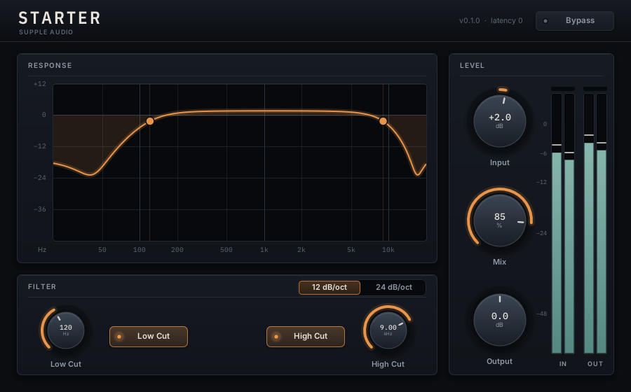

# Supple Audio plugin template

A framework and a starting product for CLAP-first audio plugins: CLAP, VST3
and AUv2 from one implementation, an SDK-free DSP engine, and a Pugl/NanoVG
editor toolkit with Metal on macOS and OpenGL on Linux and Windows.



A new product is one command away and builds, passes every test and opens in
a host as created. You then write three things: a parameter table, a
processor and an editor layout. Host plumbing, sample-accurate automation,
state, bypass, latency, telemetry, metering, gestures, keyboard access, text
entry, menus, HiDPI and resizing are the framework's.

## Start a product

```sh
cmake -DNAME="Name" -DID=com.suppleaudio.name -DCODE=NmXx -DDEST=../name \
      -P framework/tools/new_product.cmake            # or start from an example: -DEXAMPLE=duck
cd ../name && git init
cmake --preset release && cmake --build --preset release && ctest --preset release
```

`ID` and `CODE` (the AU subtype) identify sessions forever once shipped.

## What you edit

```
product/
  product.cmake   identity, kind, layouts, capabilities, sources
  Params.h        every parameter: one row each
  Properties.h    state that is not a parameter (optional)
  Presets.h       factory presets (optional, with PRODUCT_PRESETS ON)
  Processor.h     the DSP
  Editor.cpp      layout and the product's own drawing
  Theme.h         the palette
  test/           measured claims about the DSP
framework/        shared, identical in every product -- change it in the template
```

The starter product here is a utility filter (input gain, 12/24 dB/oct
Butterworth low and high cuts, mix, output gain), bit-transparent at its
defaults, with a live response graph whose handles drag. It shows every kind of
control and every pattern the framework expects; replace it.

`examples/` holds small products for what the starter does not use, each a
starting point of its own (`-DEXAMPLE=<name>`) and each built and tested on
every framework change (`framework/tools/test_examples.cmake`). They live
beside `framework/`, not in it, so products do not carry them.

| Example | What it shows |
| --- | --- |
| `instrument` (Tone) | Notes at their exact sample, voices and voice info, note ends for the host, pitch bend and the mod wheel, tuning and volume note expressions, per-note modulation of a parameter |
| `pulse` (Pulse) | A tempo-synced rate, framework-smoothed parameters, a level off at its minimum (-inf dB), an output parameter the host displays, factory presets in categories and the preset bar |
| `duck` (Duck) | A sidechain input, a named aux output, surround (5.1, 7.1.4) and ambisonic layouts |
| `chord` (Chord) | A note effect: notes and MIDI in and out, no audio, notes sent at exact frames; properties (a chord typed as text, a per-project label) and presets that set them |

Bigger capabilities are switched on in `product.cmake` (`PRODUCT_SIDECHAIN ON`,
`PRODUCT_AUX_OUTPUTS "Kick" "Snare"`, `PRODUCT_NOTE_OUTPUT ON`, `PRODUCT_PRESETS ON`, ...); a product
that switches nothing on is a plain effect or instrument.

## Read next

- [framework/AGENTS.md](framework/AGENTS.md): how to build a product on
  this, for agents and people alike.
- [framework/docs/BUILDING.md](framework/docs/BUILDING.md): platforms,
  presets, every test, the tools.
- [framework/docs/CONVENTIONS.md](framework/docs/CONVENTIONS.md): why
  things are the way they are.

## Status

Built and tested on Linux (X11/OpenGL): every test in the release, debug,
AddressSanitizer, ThreadSanitizer and RealtimeSanitizer presets, clap-validator, X11 embedding,
and REAPER loading the CLAP. macOS (Metal, AUv2) is built and tested by CI
(see [BUILDING.md](framework/docs/BUILDING.md#continuous-integration)):
every test, `auval`, pluginval, clap-validator, and the editor opening in a
Cocoa window, on a 1x virtual machine; open it in real hosts on real
hardware before shipping. Windows (MSVC, OpenGL) is built and tested by CI
the same way, editor embedding included, on a runner without a GPU; open it
in real hosts on a real Windows machine before shipping.

## License

The template, framework included, is MIT licensed, copyright (c) 2026 Supple
Audio ([LICENSE](LICENSE)). Products choose their own: `new_product.cmake`
defaults to GPL-3.0-or-later for `product/` and leaves `framework/` MIT.
Third-party notices: [framework/THIRD_PARTY.md](framework/THIRD_PARTY.md),
full texts in [framework/NOTICES.txt](framework/NOTICES.txt).
