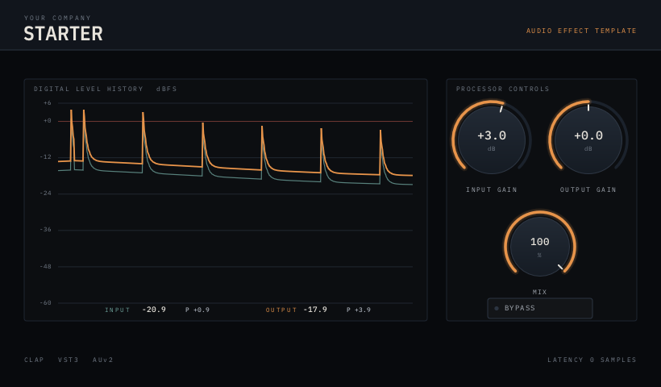

# Audio Plugin Template

A working CLAP-first audio effect with VST3 and AUv2 wrappers, a custom
Pugl/NanoVG editor, Metal rendering on macOS, OpenGL on Linux and Windows, and
host-level integration probes. It distills the reusable infrastructure and
engineering conventions established in Ferric and Plateau without carrying
either product's DSP or identity into the next plugin.

The included processor is intentionally transparent. Input Gain, Output Gain,
Mix and Bypass prove that parameters, automation, state, smoothing, float and
double audio, meters, gestures and every wrapper are connected. Replace the
identity operation in `dsp/include/starter/Processor.h` with the new product's
DSP; do not build a product by accumulating hacks in the wrapper.

## Start here

1. Read `AGENTS.md` and `CONVENTIONS.md` before changing code.
2. Follow the identity checklist in `CUSTOMIZE.md` before opening the project
   in a DAW. Plugin IDs and AU four-character codes must be unique forever.
3. Build and run the untouched baseline once, following `BUILDING.md`.
4. Add DSP behind `starter::Processor`, extend the single parameter table, and
   add independent measurements for every important sonic or marketing claim.
5. Exercise the built CLAP bundle with `starter-clap-probe`; the standalone GUI
   preview does not validate embedding, wrapper timers, resizing or teardown.

## Repository map

- `dsp/include/starter/Processor.h` — SDK-free, testable DSP core and the
  explicit product-DSP insertion point.
- `plugin/src/StarterParams.h` — the only parameter metadata and formatter.
- `plugin/src/starter_clap.cpp` — CLAP lifecycle, sample-accurate automation,
  versioned state, audio ports, telemetry gating and GUI bridge.
- `plugin/gui` — renderer-independent editor/window code, custom Pugl Metal
  backend, NanoVG Metal/OpenGL seams, widgets, theme and embedded fonts.
- `test` — deterministic DSP and input/gesture tests.
- `tools/starter_cli.cpp` — offline WAV renderer for DSP measurements and
  block-boundary debugging without a DAW.
- `tools/clap_host_probe.cpp` — a small real CLAP host for bundle-level GUI and
  audio tests.
- `tools/gui_preview.cpp` — image rendering for visual review only.

The root project deliberately has no product license. Choose one for the new
product rather than accidentally inheriting a template-wide decision. Required
dependency and font notices are summarized in `THIRD_PARTY.md`.
